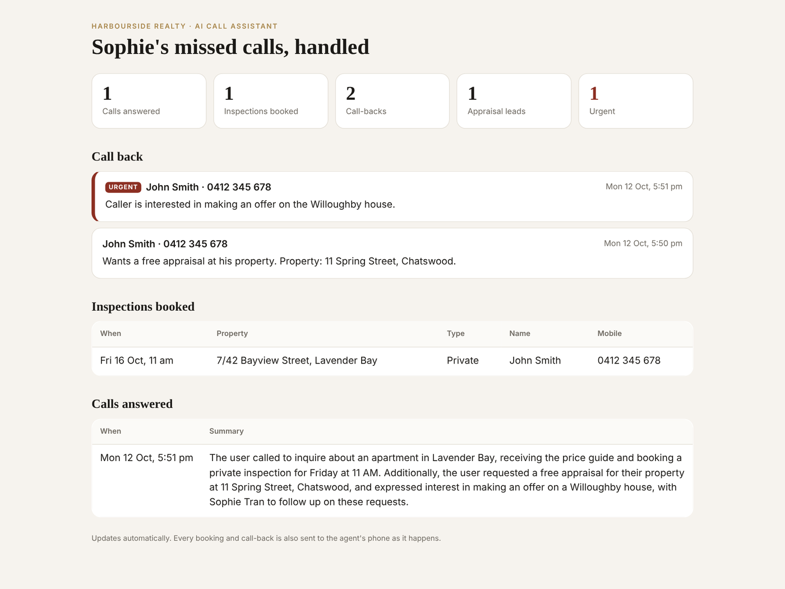

# AI Voice Receptionist

An AI phone assistant for **real estate agents**, built on [Vapi](https://vapi.ai). When an agent can't pick up (with a client, at an open home, in an appraisal), the call diverts to it instead of voicemail. It talks like a person, answers questions about the listings, **books inspections** into real open-home and private times, and takes the details so the agent can call straight back, flagging anything urgent like an offer. It can also run as the whole agency's reception line.

https://github.com/user-attachments/assets/c38ff75a-edfa-47b2-9149-61500f1b2544

**Demo (4 min):** a real, unedited call with the assistant, then the page the agent sees afterwards. ([download the video](docs/demo.mp4))

## What it does

- Answers from your own listing data, so it never invents prices, times or policies
- Books and cancels open homes and private inspections, with no double-booked private slots and no made-up times
- Takes messages (appraisals, contracts, offers, maintenance) and passes them to the right agent, marking offers and deadlines urgent
- Reads phone numbers back digit by digit, and offers to use the caller ID instead of making people read their number out
- Remembers the caller: never asks for a name or number twice in a call, and recognises repeat callers by caller ID
- Patient turn-taking: waits for people who pause or read their number out in pieces, instead of cutting them off
- Never just says "I'll pass that on": every request is saved through a tool, and a safety net saves a call-back from the call summary if the AI ever forgets
- Sends every booking, message and call summary to Telegram, and shows them on the agent's page (urgent call-backs first)
- Works on a phone number or straight from a web page ("Talk to us" button)
- Easy to change: listings and inspection rules live in one JSON file, the script in one text file
- Tested (41 tests), Docker-ready, MIT licensed

> Agent line or reception: set `line_agent` in `data/agency.json` to answer one agent's mobile ("you've reached Sophie Tran… I'm Clara, Sophie's virtual assistant"), or remove it to answer as the agency's front desk.

> The demo agency, **Harbourside Realty**, is fictional, and so are its listings and agents (`data/agency.json`).

## What a call looks like

This is the tool side of a call, replayed with `scripts/simulate_call.py`. Between these steps the assistant talks to the caller in its own words.

```text
Caller: What's the price guide for the Lavender Bay apartment?
Tool:   unit 7 at 42 Bayview Street, Lavender Bay (HR-101) is for sale: 2 bedrooms, 2 bathrooms, 1 car space.
        Price: one point four five to one point five five million dollars. ...
        Caller ID: zero four one two, three four five, six seven eight.

Caller: Could I come by on Friday?
Tool:   On Friday 16 October: private inspections every half hour from 10 am to 4:30 pm.

Caller: The first one works. I'm Jordan Lee.
Tool:   Not booked yet. Ask: "Is the number you're calling from, ending in six seven eight,
        the best one to reach you on?"

Caller: Yes, that's fine.
Tool:   Booked: private inspection at unit 7 at 42 Bayview Street on Friday 16 October at 10 am for Jordan Lee.

Caller: Could Sophie do a free appraisal of my place? It's 5 Rose Street, Mosman.
Tool:   Message saved for Sophie Tran. Tell the caller they'll get a call back as soon as Sophie's free.

Caller: And I'd like to put an offer in on the Willoughby house.
Tool:   Message saved for Sophie Tran and flagged urgent.
```

The caller gives their name once and never reads out their number: the server remembers both for the rest of the call, and recognises the number next time. Phone numbers come back already spelled out ("zero four one two…") so the voice reads them digit by digit, the way a person would.

The agent gets a Telegram message for the booking, another for each call-back (urgent ones flagged), and a short summary when the call ends.



## How it works

```text
 Caller ──phone or browser──▶  Vapi  (speech-to-text, AI model, voice)
                                 │  "book_inspection(...)"
                                 ▼
                     this server (FastAPI)  ── checks the time is real and free
                                 │             saves to SQLite, notifies Telegram
                                 ▼
                     returns a plain-English result that the assistant reads back
```

Vapi handles the call audio and the conversation. This server owns the facts and the actions. The AI model can *ask* for any time it likes, but `book_inspection` only accepts a time that `find_inspection_times` actually offered, in the future, with enough notice, and not already taken. That's what keeps a voice bot from inventing appointments.

| Tool | What it does |
|---|---|
| `get_listing_details` | Finds a listing by address, suburb or ID and returns its facts |
| `find_inspection_times` | Upcoming open homes plus free private-inspection slots, in plain English, each with a booking code |
| `find_inspection_times` with `day` | Every free time on the day the caller asked for, or why there's none (too soon, weekend, fully booked) and the nearest options |
| `book_inspection` | Validates the slot and books it; won't book until the number has been read back or the caller has OK'd their caller ID |
| `cancel_inspection` | Finds the caller's booking by their number and cancels it, telling the agent |
| `take_message` | Saves a call-back for the right agent, flagged urgent for offers and deadlines (asks for the property address on new appraisals) |

The call ends by itself after Clara says "Thanks for calling, have a great day", so the goodbye is never cut off.

## Quick start (local, no Vapi account needed)

```bash
git clone https://github.com/buildering-dev/ai-voice-receptionist.git
cd ai-voice-receptionist
pip install -r requirements-dev.txt
pytest                                           # 41 tests
uvicorn receptionist.server:app --port 8000      # the webhook server
python scripts/simulate_call.py                  # replays a call against it
```

Then open http://localhost:8000/admin?token=... after setting `ADMIN_TOKEN` to see the agent's page: call-backs (urgent first), bookings and call summaries.

### Try a real voice call on Windows

`start_voice_demo.bat` does everything in one go: it starts the server, opens a free Cloudflare quick tunnel so Vapi can reach it, updates the assistant in your Vapi account, and prints a link. You need `VAPI_API_KEY` (private) and `VAPI_PUBLIC_KEY` set as user environment variables, and `cloudflared.exe` in the folder. Then open http://localhost:8000 and click **Start call**. The optional "Pretend caller ID" box shows how it behaves on a real phone line.

## Go live with Vapi

1. **Host the server** somewhere with a public HTTPS URL: any small VPS, Render, Railway or Fly.io (`docker compose up -d` works as is). For a quick test, a free Cloudflare quick tunnel (`cloudflared tunnel --url http://localhost:8000`) is enough.
2. **Copy `.env.example` to `.env`** and set `SERVER_URL`, a long random `WEBHOOK_SECRET`, and `ADMIN_TOKEN`.
3. **Create the assistant** in your Vapi account:
   ```bash
   export VAPI_API_KEY=...        # private key from the Vapi dashboard; never commit it
   python scripts/push_assistant.py
   ```
   Run it again after you change the script or the data, and it updates the same assistant.
4. **Talk to it:** in the Vapi dashboard, or put `VAPI_PUBLIC_KEY` and `VAPI_ASSISTANT_ID` in `.env` and open the server's home page for a browser call. To take real calls, buy or import a phone number in Vapi and attach the assistant.

## Make it yours

- **Listings, open homes, inspection rules, office hours, agents:** `data/agency.json`. In production this would be fed from your CRM or listing portal export.
- **Whose phone it answers:** `line_agent` in `data/agency.json` (one agent's mobile when they can't pick up), or remove it to answer as the agency's reception.
- **What it says and how:** `prompts/receptionist.md` (tone, rules, what to hand to a human).
- **How it pronounces things:** `voice.chunkPlan.formatPlan` in `receptionist/assistant.py` (unit addresses as "unit seven at forty-two", numbers over 99 digit by digit).
- **Model and voice:** `LLM_MODEL`, `VOICE_PROVIDER` and `VOICE_ID` in `.env` (any model or voice Vapi supports). `gpt-4.1` follows the "don't ask twice" rules more reliably than the mini models for a few cents more per call.
- **How long it waits before replying:** `startSpeakingPlan` in `receptionist/assistant.py`. It already waits longer while the caller is giving a number, email or address; raise `waitSeconds` for slower callers.
- **Notifications:** set `TELEGRAM_BOT_TOKEN` and `TELEGRAM_CHAT_ID`, or swap `receptionist/notify.py` for email, SMS or your CRM.

## Running costs

There's no monthly platform subscription. Vapi bills per minute, typically about **US$0.10–0.20 per minute** all-in (speech, AI model, voice and phone line), plus about US$2 a month per phone number. A 3-minute enquiry call costs roughly 30–60 cents. Hosting the server costs a few dollars a month. Check [Vapi's pricing](https://docs.vapi.ai/pricing) for current rates.

## Safety and privacy

- The webhook rejects requests without the shared secret, and `/admin` is off unless `ADMIN_TOKEN` is set.
- The receptionist only states facts returned by the tools. It won't give legal, financial or valuation advice, won't discuss other callers, and tells callers to ring 000 in an emergency.
- Only the details needed for a booking or message are stored (name, phone, optional email), in a local SQLite file you control. Call recordings stay in your Vapi account; turn them off there if you don't need them.
- Tell callers they're speaking with an AI assistant where your local rules require it. The first message can be changed in `receptionist/assistant.py`.

## Project layout

```text
receptionist/
  agency.py      listings, open homes, private-inspection slots (all date maths lives here)
  tools.py       the five tools, with validation and caller memory
  server.py      FastAPI webhook, demo page, call-back safety net
  admin.py       the agent's page
  assistant.py   builds the Vapi assistant (prompt, voice, tools, call analysis)
  store.py       SQLite: bookings, messages, call reports
  notify.py      Telegram (or log) notifications
data/agency.json       the fictional agency
prompts/receptionist.md
scripts/push_assistant.py   create or update the assistant via the Vapi API
scripts/simulate_call.py    replay a call without paying for minutes
web/index.html              browser demo (Vapi Web SDK)
start_voice_demo.bat        one-click local voice demo (server + tunnel + assistant update)
docs/                       demo video and screenshots
tests/                      41 tests: scheduling, booking rules, caller memory, number reading, webhook, safety net, assistant definition
```

## Licence

MIT. Built by [buildering-dev](https://github.com/buildering-dev).
